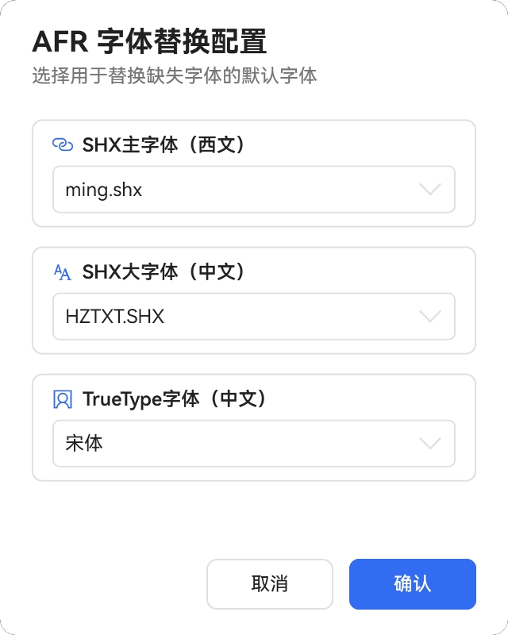
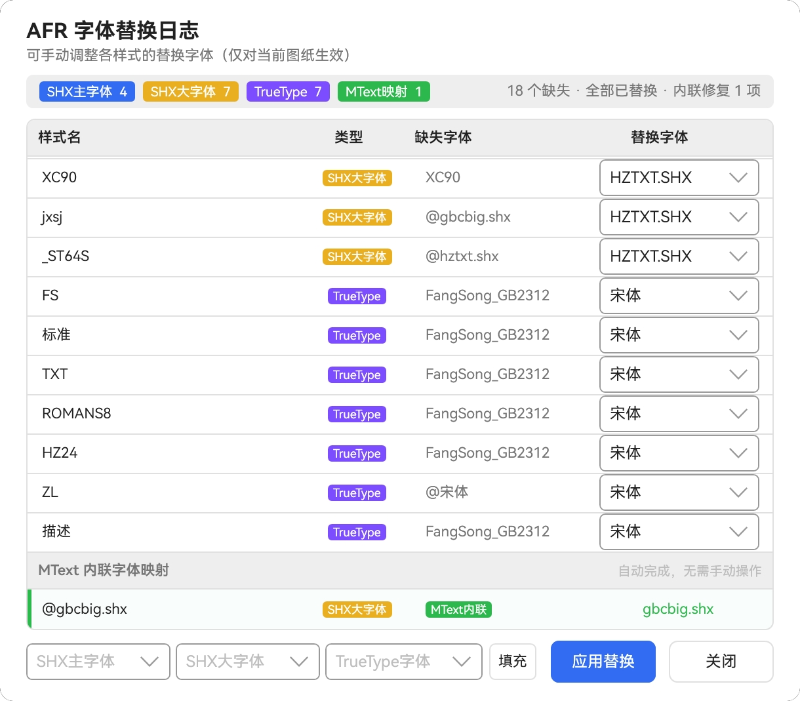

# 功能介绍

## AFR · 缺失字体自动替换

打开缺少字体的 CAD 图纸时，AFR 会识别并替换缺失字体，并保留替换记录供你检查。替换目标由你选择，适用于 SHX 主字体、SHX 大字体和 TrueType 字体。

### 自动处理图纸中的缺失字体

安装并启用插件后，打开含有缺失字体的图纸即可触发处理。多行文字（MText）中的内联字体也会自动映射。

请检查实际显示效果再保存图纸。如果文字数据本身已损坏，字体替换无法恢复原文。

### 设置常用的替换字体

在 AutoCAD 命令行输入 `AFR`，选择三类字体的替换目标。默认配置为：

| 字体类型 | 默认替换字体 |
| --- | --- |
| SHX 主字体 | `ming.shx` |
| SHX 大字体 | `tssdchn.shx` |
| TrueType 字体 | 宋体 |

详细操作见[首次配置与验证](../../README.md#首次配置与验证)。字体文件与来源见[字体资源](../autodesk-fonts.md)。

### 查看和调整替换结果

输入 `AFRLOG` 查看当前图纸的缺失字体及替换目标。可以逐条调整，也可以批量填充，确认后点击“应用替换”。每次打开日志都会读取当前图纸状态。

MText 内联字体采用自动映射，不支持在日志中手动替换。

如果替换后文字显示异常，先不要保存图纸；使用 `AFRLOG` 重新选择字体，确认显示正常后再保存。详见[手动调整](../../README.md#手动替换)和[常见问题](../../README.md#afr-常见问题)。

## 开始使用

先[核对 AutoCAD 版本与运行环境](../../README.md#兼容范围)，再按[安装指南](../../README.md#快速开始)操作。已安装旧版本的使用者请先阅读[升级与恢复](../../README.md#9x-手动迁移与恢复)。
